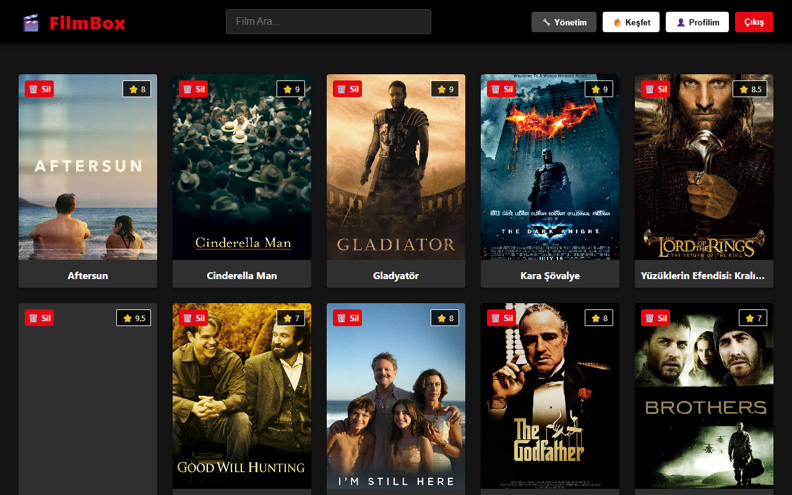
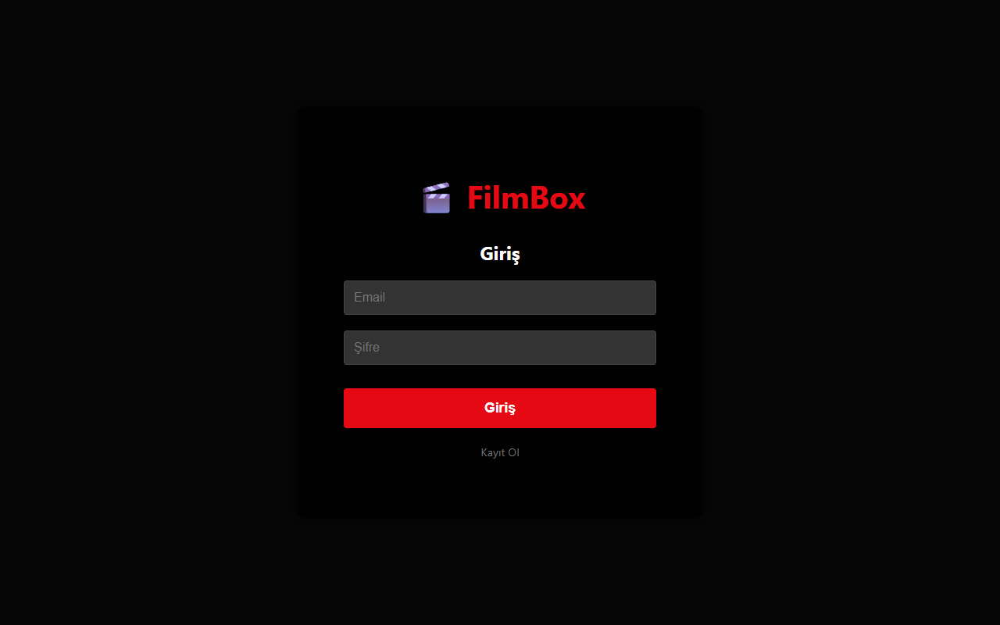
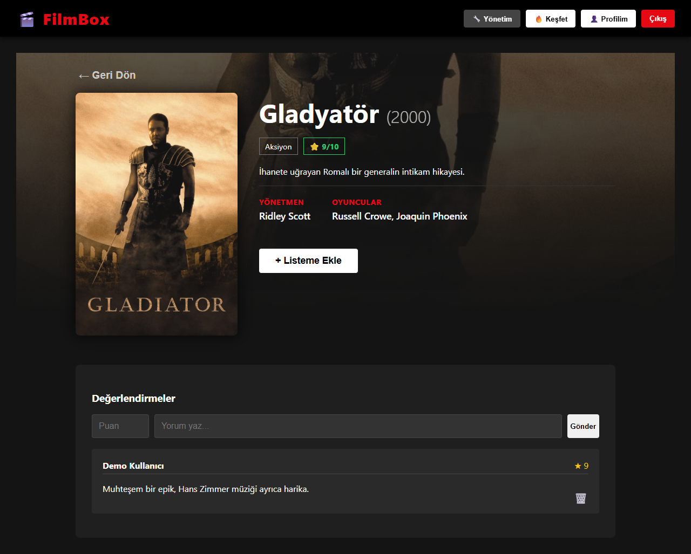
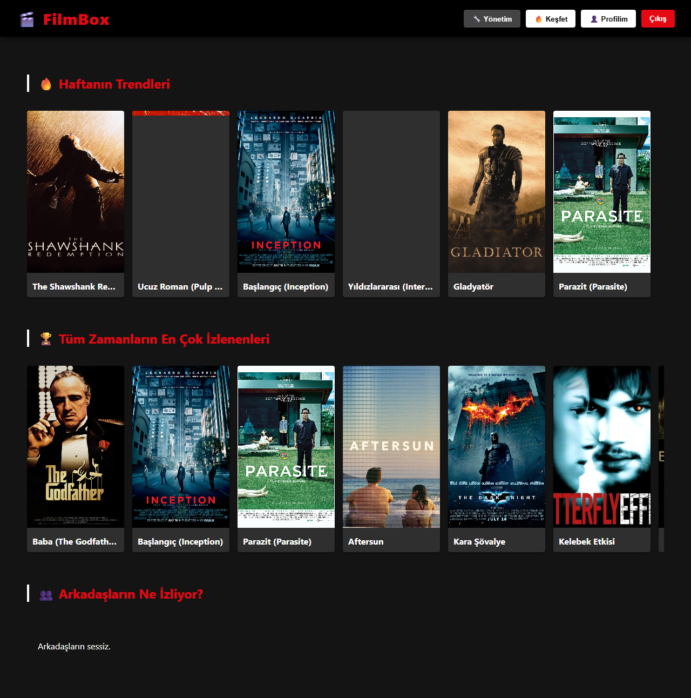
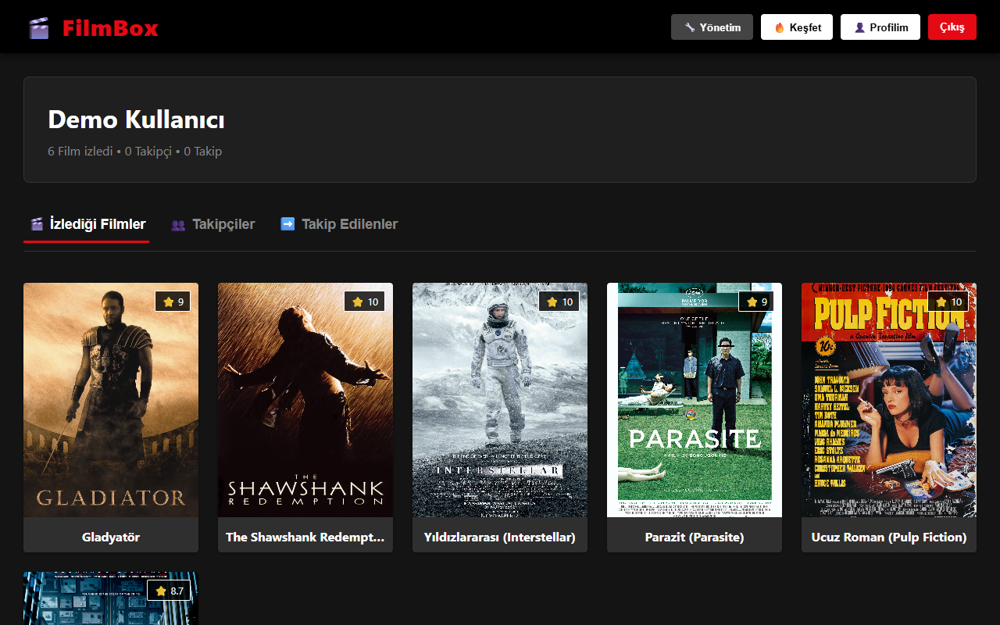
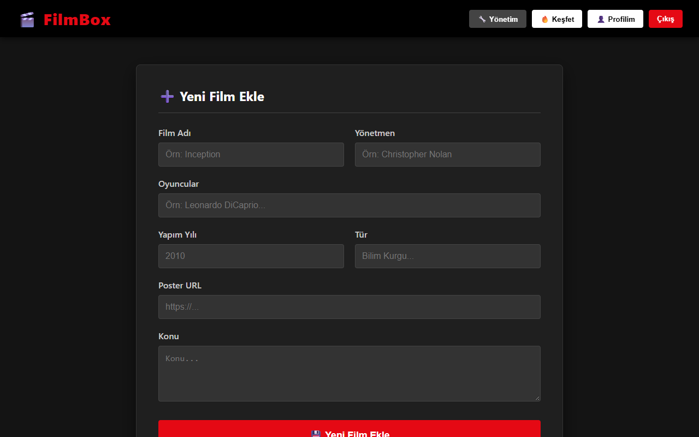

# 🎬 FilmBox: Film Puanlama ve Sosyal Keşif Platformu

FilmBox, kullanıcıların filmleri puanlayıp yorumlayabildiği, izleme listesi oluşturabildiği ve arkadaşlarını takip ederek **ne izlendiğini keşfedebildiği** tam yığın (full-stack) bir web uygulamasıdır. Backend **Spring Boot + PostgreSQL**, arayüz **React** ile geliştirilmiştir. Ortalama puan, trend ve öneri listeleri, veritabanı tarafında yazılmış **PostgreSQL fonksiyonları ve trigger'ı** ile üretilir.



## Özellikler

**Kullanıcılar**
- Kayıt olma ve giriş yapma (`USER` / `ADMIN` rolleri)
- Şifreler **BCrypt** ile hashlenir; API cevaplarında şifre asla dönmez
- **Spring Security + JWT** ile kimlik doğrulama; film yönetimi yalnızca `ADMIN` rolüne açıktır
- Üst üste 3 hatalı girişte arayüzde geçici kilitleme (10 saniye)
- Oturumun tarayıcıda saklanması (sayfa yenilense de giriş korunur)

**Filmler ve değerlendirmeler**
- Afiş kartlarıyla film listesi ve ada göre anlık arama
- Film detay sayfası: konu, yönetmen, oyuncular, tür, yapım yılı, ortalama puan
- 1–10 arası puan ve yorum yazma, kendi yorumunu silme
- Kişisel **izleme listesine** film ekleme

**Sosyal özellikler**
- Kullanıcı profilleri: izlenen filmler, takipçiler ve takip edilenler sekmeleri
- Kullanıcı takip etme / takibi bırakma

**Keşfet ekranı**
- 🔥 Haftanın trend filmleri
- 🏆 Tüm zamanların en çok izlenenleri
- 👥 Arkadaşların bu hafta izledikleri

**Yönetim paneli (ADMIN)**
- Film ekleme, düzenleme ve silme
- Herhangi bir yorumu silme

## Ekran Görüntüleri

| Giriş | Film detayı ve yorumlar |
|---|---|
|  |  |

| Keşfet | Profil |
|---|---|
|  |  |

| Yönetim paneli |
|---|
|  |

## Mimari

```
React (film-frontend, :3000)  ──REST/JSON──►  Spring Boot API (:8080)  ──JPA/Hibernate──►  PostgreSQL
                                                  │                                            │
                                      controller / repository / model              fonksiyonlar + trigger
```

```
film_puanlama/
├── src/main/java/com/example/filmpuanlama/
│   ├── controller/    Film, Kullanici, Degerlendirme, IzlemeListesi, Takip
│   ├── model/         Film, Kullanici, Degerlendirme, IzlemeListesi, Takip (JPA varlıkları)
│   ├── repository/    Spring Data JPA depoları (Keşfet için native sorgular dahil)
│   └── config/        SecurityConfig, JwtService, JwtFilter, WebConfig (CORS, BCrypt), VeriYukleyici (örnek veri)
├── src/main/resources/
│   ├── application.properties
│   └── schema.sql     PostgreSQL fonksiyonları, prosedürleri ve trigger (her açılışta uygulanır)
├── docs/screenshots/  README görselleri
└── film-frontend/     React arayüzü
```

### Veri Modeli

| Tablo | Açıklama |
|---|---|
| `filmler` | Film bilgileri ve ortalama puan |
| `kullanicilar` | Kullanıcılar ve roller |
| `degerlendirmeler` | Kullanıcı–film puan ve yorumları (çoktan-çoğa ilişki) |
| `izleme_listesi` | Kullanıcı–film izleme listesi kayıtları (kullanıcı+film tekil) |
| `takipler` | Kullanıcılar arası takip ilişkisi (takip eden+edilen tekil) |

### REST API

Giriş (`POST /api/kullanicilar/giris`) bir **JWT** döndürür; diğer tüm uç noktalar `Authorization: Bearer <token>` başlığı ister (yoksa/geçersizse `401`). Token 24 saat geçerlidir.

| Yetki | Kapsam |
|---|---|
| Herkese açık | `POST /api/kullanicilar/giris`, `POST /api/kullanicilar/kayit` |
| Giriş yapmış kullanıcı | Film/yorum okuma, yorum ekleme, izleme listesi, takip |
| Yalnızca `ADMIN` | Film ekleme, güncelleme, silme (`POST/PUT/DELETE /api/filmler`) |
| Sahibi veya `ADMIN` | Yorum silme (başkasının yorumunda `403`) |

Yorum, izleme listesi ve takip işlemlerinde kullanıcı kimliği istek gövdesinden değil token'dan alınır; başka biri adına işlem yapılamaz.

| Kaynak | Uç noktalar |
|---|---|
| Filmler `/api/filmler` | `GET` listele · `POST` ekle · `PUT /{id}` güncelle · `DELETE /{id}` sil (yorum ve liste kayıtlarıyla) · `GET /populer` · `GET /trendler` · `GET /arkadas-onerileri/{kullaniciId}` |
| Değerlendirmeler `/api/degerlendirmeler` | `GET /film/{filmId}` · `POST` yorum ekle (puan 1–10) · `DELETE /{id}` |
| İzleme listesi `/api/izleme-listesi` | `GET /{kullaniciId}` · `POST /ekle` · `POST /cikar` |
| Takip `/api/takip` | `POST /et` · `POST /birak` · `GET /ettikleri/{userId}` · `GET /takipcileri/{userId}` |
| Kullanıcılar `/api/kullanicilar` | `POST /giris` (hatalıysa `401`) · `POST /kayit` (email çakışmasında `409`) |

Hatalar uygun HTTP kodlarıyla (`400`, `401`, `404`, `409`) ve `message` alanıyla döner.

### Veritabanı Nesneleri

Tanımları [`schema.sql`](src/main/resources/schema.sql) dosyasındadır ve uygulama her açıldığında (tablolar oluştuktan sonra) idempotent olarak uygulanır; ayrıca elle kurulum gerekmez.

| Nesne | Görevi |
|---|---|
| `en_cok_izlenenleri_getir(limit)` | İzleme listelerinde en çok yer alan filmler |
| `bu_hafta_en_cok_izlenenleri_getir(limit)` | Son 7 günde izleme listesine en çok eklenen filmler |
| `arkadaslarin_bu_hafta_izledikleri(kullanici_id, limit)` | Takip edilen kullanıcıların son 7 günde izleme listesine ekledikleri |
| Trigger `tetikleyici_puan_guncelle` (`puan_hesapla()`) | Yorum eklendiğinde/değiştiğinde/silindiğinde filmin ortalama puanını günceller |
| `film_sil`, `izleme_listesini_temizle`, `kullanici_sifre_sifirla` | Yönetim amaçlı yardımcı prosedürler (psql ile `CALL ...`) |

## Kullanılan Teknolojiler

- **Backend:** Java 17, Spring Boot 4, Spring Web MVC, Spring Data JPA (Hibernate), Spring Security + JWT (jjwt), BCrypt, Maven
- **Frontend:** React 19, Create React App, Fetch API, CSS
- **Veritabanı:** PostgreSQL (saklı fonksiyonlar, prosedürler, trigger, native sorgular)

## Kurulum ve Çalıştırma

### Gereksinimler
- JDK 17+
- Node.js 18+ ve npm
- PostgreSQL

### 1. Veritabanı

```sql
CREATE DATABASE film_puanlama_db;
```

Tablolar Hibernate (`ddl-auto=update`), fonksiyonlar ve trigger ise `schema.sql` ile uygulama ilk çalıştığında oluşturulur. Veritabanı şifresi ortam değişkeninden okunur:

```bash
export DB_PASSWORD=postgres_sifreniz        # Windows PowerShell: $env:DB_PASSWORD="..."
```

İsteğe bağlı ortam değişkenleri:

| Değişken | Varsayılan | Açıklama |
|---|---|---|
| `DB_URL` | `jdbc:postgresql://localhost:5432/film_puanlama_db` | JDBC bağlantı adresi |
| `DB_USER` | `postgres` | Veritabanı kullanıcısı |
| `CORS_ORIGINS` | `http://localhost:3000` | API'ye erişebilen arayüz adresleri (virgülle ayrılır) |
| `JWT_SECRET` | *(rastgele üretilir)* | Token imza anahtarı, **en az 32 karakter**. Tanımlanmazsa her açılışta yeni anahtar üretilir ve oturumlar sıfırlanır; kalıcı kullanım için mutlaka tanımlayın |

### 2. Backend

```bash
git clone https://github.com/MelihAliCagman/film_puanlama.git
cd film_puanlama
./mvnw spring-boot:run                      # Windows: mvnw.cmd spring-boot:run
```

API `http://localhost:8080` adresinde çalışır. Film tablosu boşsa uygulama örnek bir film, kullanıcı (`melih@test.com` / `1234`) ve yorum ekler.

### 3. Frontend

```bash
cd film-frontend
npm install
npm start
```

Arayüz `http://localhost:3000` adresinde açılır. API farklı bir adreste ise `REACT_APP_API_URL` ortam değişkeniyle belirtilebilir (varsayılan `http://localhost:8080`).

Testler: `npm test` (frontend), `./mvnw test` (backend, çalışan bir PostgreSQL ve `DB_PASSWORD` gerektirir).

### Yönetici (ADMIN) hesabı

Kayıt ekranı her zaman `USER` rolü verir; rol istemciden alınmaz. Bir hesabı yönetici yapmak için:

```sql
UPDATE kullanicilar SET rol = 'ADMIN' WHERE email = 'hesabinizin@emaili.com';
```

> Eski (düz metin) şifreler, sahibi ilk başarılı girişte yaptığında otomatik olarak BCrypt'e çevrilir.

## Bilinen Sınırlar ve Yol Haritası

- Token şu an `localStorage`'da tutuluyor; daha sıkı güvenlik için `HttpOnly` çerez + refresh token düşünülebilir
- Giriş denemesi sınırı yalnızca arayüzde; sunucu tarafında hız sınırlama eklenmeli
- Sayfalama ve film posteri yükleme
- Docker Compose ile tek komutla kurulum
- Backend için entegrasyon testleri (Testcontainers)

## Katkı

Hata bildirimi ve önerileriniz için issue açabilirsiniz.
